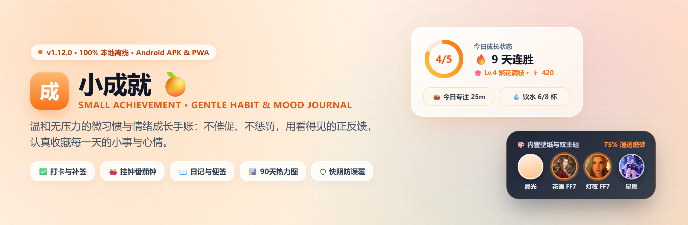
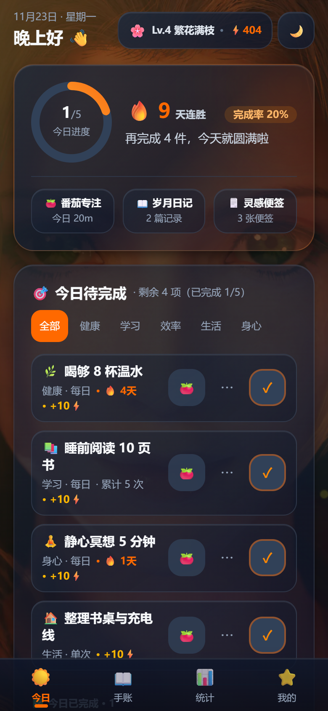
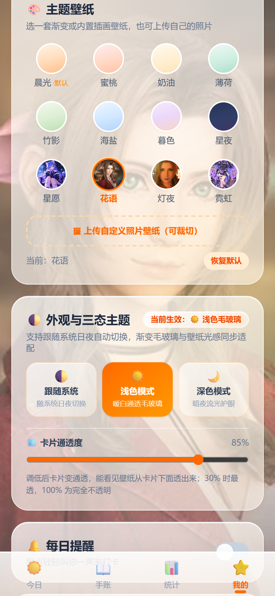
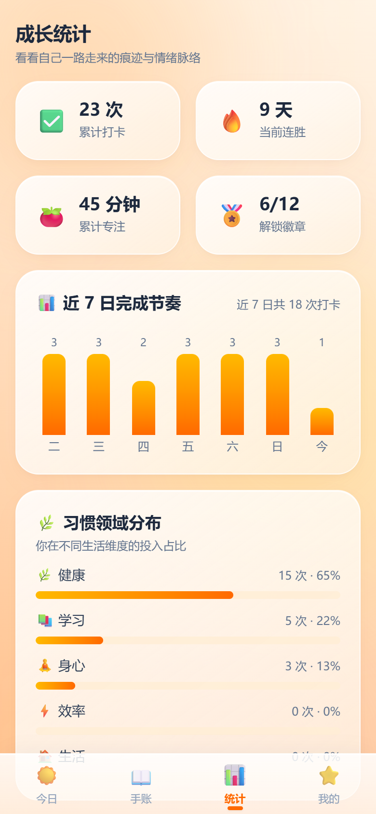

<div align="center">



# 小成就 🍊 · Small Achievement

### _温和无压力的微习惯打卡、挂钟番茄专注与情绪成长手账_

**打卡 · 番茄专注 · 岁月日记 · 灵感便签 · 成长统计 · 100% 本地离线存本机**

[](https://github.com/wcx1208/small-achievement/releases/latest)
[](https://github.com/wcx1208/small-achievement/stargazers)
[](https://github.com/wcx1208/small-achievement/releases/latest)
[](LICENSE)

[](https://react.dev)
[](https://www.typescriptlang.org)
[](https://tailwindcss.com)
[](https://capacitorjs.com)
[](#%E6%9C%AC%E5%9C%B0%E5%BC%80%E5%8F%91%E4%B8%8E%E6%9E%84%E5%BB%BA)
[](#%E9%9A%90%E7%A7%81%E4%B8%8E%E6%95%B0%E6%8D%AE%E8%87%AA%E4%B8%BB)

<p>
  <a href="https://wcx1208.github.io/small-achievement/"><strong>🌐 在线体验网页版（PWA）</strong></a>
  &nbsp;·&nbsp;
  <a href="https://github.com/wcx1208/small-achievement/releases/latest"><strong>📦 下载 Android APK（v1.12.0）</strong></a>
  &nbsp;·&nbsp;
  <a href="#-%E7%95%8C%E9%9D%A2%E9%A2%84%E8%A7%88"><strong>📱 界面预览</strong></a>
  &nbsp;·&nbsp;
  <a href="#-%E5%B7%A5%E7%A8%8B%E4%B8%8E%E5%8F%AF%E9%9D%A0%E6%80%A7%E8%AE%BE%E8%AE%A1"><strong>🛡 工程与可靠性</strong></a>
</p>

</div>

---

「**小成就**」面向想缓解拖延、轻盈记录生活与情绪变化的个人用户。它**不催促、不惩罚、不制造连续打卡焦虑**——每完成一件微小习惯、写下一段心情或完成一次专注，都会给你温柔可见的正反馈：**连胜天数、成长能量、12 枚徽章、彩带与细腻触感**。

**同一份 React + TypeScript 代码**同时构建 **Android 原生封装 APK** 与 **可离线安装的 PWA 网页版**，全部数据仅保存在你自己的设备本地，无任何后台上传。

---

## 📱 界面预览

<div align="center">
<table>
  <tr>
    <td align="center" width="33%">
      <strong>☀️ 今日打卡 · 暖阳浅色</strong><br/><br/>
      
    </td>
    <td align="center" width="33%">
      <strong>🌙 深色通透磨砂 · 内置灯夜壁纸</strong><br/><br/>
      
    </td>
    <td align="center" width="33%">
      <strong>🎨 壁纸与外观自定义 · 卡片通透度</strong><br/><br/>
      
    </td>
  </tr>
</table>
<table>
  <tr>
    <td align="center" width="50%">
      <strong>📖 时光手账 · 岁月日记 / 灵感便签 / 情绪流</strong><br/><br/>
      
    </td>
    <td align="center" width="50%">
      <strong>📊 成长统计 · 90 天热力图与 30 天心情趋势</strong><br/><br/>
      
    </td>
  </tr>
</table>
</div>

---

## ✨ 核心功能一览

<table>
<tr>
<td width="50%" valign="top">

### ✅ 微习惯与待办打卡
1. 五大生活维度：健康 / 学习 / 效率 / 生活 / 身心分类管理。
2. 灵活清单流：支持每日习惯、单次待办、习惯灵感库一键添加。
3. 补卡与归档：近 7 日历史回看与一键补签；支持归档保留历史，也支持彻底删除。

### 🍅 挂钟番茄专注
1. 5 / 15 / 25 / 45 分钟四档预设，支持绑定任务一键联动打卡。
2. 挂钟防漂移计时：状态全局托管（切换底部 Tab 不中断），锁屏、后台切回自动按真实时间戳校准。
3. 异常保护与预约通知：APK 内使用系统 `LocalNotifications` 到点提醒；App 被强杀或超时后自动安全恢复或补结算。

### 🌱 成长能量与徽章墙
1. 每次打卡、专注、写日记、记心情、饮水都在累积 ⚡ 能量。
2. Lv.1 初萌新芽 → Lv.6 岁月收藏家 6 阶成长等级。
3. 12 枚陪伴式成就徽章（解锁触发彩带礼花与触感反馈）与每日成就日签卡片。

</td>
<td width="50%" valign="top">

### 📖 手账中心与心情速记
1. 岁月日记：记录晴雨微风与心情印记，内置温和写作引导模板。
2. 灵感便签：柔和糖果色卡面，支持置顶与关键词检索。
3. 情绪流 & 时光回响：5 档心情速记，随机打捞往日片段。

### 🎨 渐变毛玻璃与壁纸系统
1. 内置 **8 套双主题渐变主题**（晨光 / 蜜桃 / 奶油 / 薄荷 / 竹影 / 海盐 / 暮色 / 星夜）与 **4 张内置插画壁纸**（星愿 / 花语 / 灯夜 / 霓虹，含两张 FF7 主题高清壁纸）。
2. 自定义照片壁纸 & 应用图标：手势缩放无损裁切、照片浓度与 **卡片通透度滑杆**，按需触发高斯模糊。
3. 浅色 / 深色 / 跟随系统三态切换，首帧预渲染零闪白。

### 💧 饮水站与安卓小组件
1. 元气饮水站置底卡片：默认 8 杯温水（2000ml），点按水滴即时反馈。
2. Android 原生桌面小组件：展示今日完成度与连胜天数，按数据变更防抖同步。

</td>
</tr>
</table>

---

## 🛡 工程与可靠性设计

「小成就」不仅关注界面温柔好看，更在数据一致性、离线可用性与边界防护上做了严格工程打磨：

1. **删除级联与历史净化**：删除任务自动级联清理关联打卡并剥离心情/专注悬空外键（归档则完整保留历史），防止连胜天数或完成率永久虚高；加载旧数据时自动净化历史孤儿记录。
2. **备份导入三道安全护栏**：
   * 导入前严格预检日期格式与时间戳合法性，拒绝脏数据污染本地库。
   * 覆盖前弹出**新旧数据条数对比确认窗**，并自动把当前数据备份至独立安全快照。
   * 设置页随时提供**一键回退到导入前数据**，并实时展示本机 5MB 存储分项占用进度条。
3. **纯粹离线与零外部依赖**：使用高质量系统字体栈（无外网字体阻塞），`Service Worker` 采用同步 `waitUntil` 托管缓存写入并由构建脚本自动注入发版版本号，彻底告别 PWA 缓存不更新与离线异常。
4. **崩溃兜底与自动化回归测试**：根级 `ErrorBoundary` 在极端异常时优先允许用户导出原始 JSON；`stats`、`storage`（白名单迁升/快照/净化）、`crop`（几何方向）、`focusSanitize` 共 **19 项单元测试**全绿守护。

---

## 📥 快速安装与使用

### 📱 Android 客户端（推荐）
前往 [**Releases**](https://github.com/wcx1208/small-achievement/releases/latest) 下载最新的 `xiaochengjiu-v1.12.0.apk`（正式签名，可直接覆盖升级保留本机全部记录）。

### 🌐 网页版（PWA 离线安装）
手机或桌面浏览器访问：[**https://wcx1208.github.io/small-achievement/**](https://wcx1208.github.io/small-achievement/)  
在浏览器菜单中选择「添加到主屏幕 / 安装应用」，即可作为独立全屏 App 离线使用。

> 两种形态数据各自保存在本机；跨设备迁移请通过「我的 → 数据自主与备份 → 导出完整备份（JSON）」。

---

## 🛠 本地开发与构建

```bash
# 1. 安装依赖
npm install

# 2. 启动本地开发服务器（已开启 --host，手机可局域网联调）
npm run dev

# 3. 类型检查与单元测试（19 项测试用例）
npm run lint
npm test

# 4. 构建生产静态产物与自动注入 SW 版本号
npm run build
```

### 打包签名 Android APK

环境要求：JDK 17 + Android SDK + Gradle 8.x（注意项目构建目录路径请勿包含中文或空格）。

```bash
npm run build
npx cap sync android
cd android
gradle :app:assembleRelease
# 产物位于：android/app/build/outputs/apk/release/app-release.apk
```

签名密钥配置于 `android/keystore.properties`（本文件与 `.keystore` 密钥文件均在 `.gitignore` 中忽略，不会上传仓库）。

---

## 📂 目录结构

```text
small-achievement/
├─ src/
│  ├─ storage/          # 单一存储清洗入口（白名单校验 / 损坏隔离 / 导入前安全快照 / 用量统计）
│  ├─ store/            # 全局 DataContext 与 FocusContext（串行写入队列 / 防抖小组件同步 / 专注边界保护）
│  ├─ data/             # 类型定义、徽章规则、鼓励语库、心情/壁纸/习惯灵感预设
│  ├─ lib/              # 日期处理、统计引擎、图片裁切几何、触感反馈与单元测试
│  ├─ components/       # BottomNav / CropModal / WeeklyOverview / ProgressRing / ErrorBoundary
│  ├─ features/         # 任务清单 / 番茄专注 / 心情记录 / 岁月日记 / 灵感便签 / 统计图表
│  ├─ pages/            # 今日打卡 / 时光手账 / 成长统计 / 我的空间
│  └─ plugins/          # Capacitor 原生小组件桥接
├─ public/              # PWA manifest、Service Worker、内置壁纸（含花语/灯夜 FF7 高清壁纸）
├─ android/             # Capacitor 安卓工程（含桌面小组件与本地通知配置）
└─ docs/                # 展示横幅、界面截图与设计文档
```

---

## 🔒 隐私与开源许可

1. **零遥测、零追踪、零服务器**：你的习惯、心情、日记与壁纸图片 100% 保存在自己的设备上。
2. 本项目基于 [MIT License](LICENSE) 开源；内置部分同人插画壁纸（花语 / 灯夜）仅供个人非商业学习欣赏使用，请勿用于商业分发。

<div align="center">

**如果「小成就」也曾温柔陪伴过你的一天，欢迎点击右上角点亮一颗 ⭐ Star 支持！**

</div>
