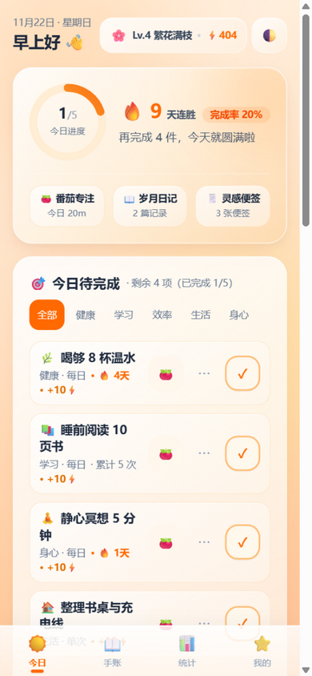

<div align="center">

# 小成就 🍊

### _A gentle habit & mood companion — 温和无压力的微习惯与情绪成长手账_

**打卡 · 番茄专注 · 心情手账 · 成长等级 · 徽章 · 全部数据存本机**

[](https://github.com/wcx1208/small-achievement/releases/latest)
[](LICENSE)
[](https://github.com/wcx1208/small-achievement/releases)
[](https://react.dev)
[](https://www.typescriptlang.org)
[](https://github.com/wcx1208/small-achievement/pulls)

**English** · [中文](#-功能一览)

A gentle, no-pressure habit tracker & mood journal. Every small win is celebrated — streaks, XP, badges, confetti and haptics — while **all data stays 100% on your device**. Ships as an Android APK and an offline-capable PWA from a single React codebase.

</div>

---

## ✨ 功能一览

<table>
<tr>
<td width="50%" valign="top">

### ✅ 习惯与打卡
- 五大分类（🌿健康 / 📚学习 / ⚡效率 / 🏠生活 / 🧘身心）
- 每日 / 单次 / 灵感习惯库 / 近 7 日补打卡
- 连胜天数与完成率看板

### 🌱 成长等级
- 打卡、番茄专注、写日记、记心情均可累积 ⚡ 成就能量
- 6 级进阶：Lv.1 初萌新芽 → Lv.6 岁月收藏家

### 🍅 番茄专注
- 5 / 15 / 25 / 45 分钟四档，可绑定任务联动打卡
- 挂钟计时：锁屏、后台不漂移；App 被杀自动恢复或补结算
- APK 内到点系统通知必达

</td>
<td width="50%" valign="top">

### 📖 手账中心
- 岁月日记：天气与心情印记，支持补记
- 灵感便签：置顶、标签过滤
- 情绪流：5 档心情速记
- 🕰 时光回响：随机重温往日记录

### 🔥 正反馈系统
- 12 枚徽章（解锁彩带 + 触感反馈）
- 90 天打卡热力图、30 天心情趋势、坚持率
- 每日一签、高光时刻回顾
- 完成即彩带 + 震动

### 🖼 个性化
- 8 套渐变壁纸 + 4 张内置插画壁纸
- 自定义照片壁纸（无损裁切 + 通透度调节）
- 深色模式（跟随系统 / 浅色 / 深色）

</td>
</tr>
</table>

## 📱 界面预览

| 今日打卡（浅色） | 今日打卡（深色 · 通透度 75%） |
| :---: | :---: |
|  |  |
| **手账中心** | **成长统计** |
|  |  |

## 📥 安装

**Android**：到 [Releases](https://github.com/wcx1208/small-achievement/releases/latest) 下载最新 APK 安装（允许"未知来源"即可）。

**网页版（PWA）**：手机浏览器打开 [在线版](https://wcx1208.github.io/small-achievement/) → 菜单选「添加到主屏幕」→ 全屏离线使用。

> 两种形态数据均存本机、互不相通；换机前用「我的 → 数据 → 导出备份」迁移。

## 🛠 本地开发

```bash
npm install
npm run dev      # 开发服务器（局域网可访问）
npm test         # 运行 12 个单元测试（stats + storage）
npm run build    # 类型检查 + 构建静态产物
npm run lint     # TypeScript 类型检查
```

### 打包 Android APK

需要 JDK 17、Android SDK、Gradle 8.x：

```bash
npm run build
npx cap sync android
cd android && ./gradlew :app:assembleDebug   # 或 assembleRelease
# 产物：android/app/build/outputs/apk/<debug|release>/app-*.apk
```

正式签名：在 `android/keystore.properties` 配置签名信息（该文件与 keystore 均不进仓库）。

## 🔒 隐私

所有记录只保存在本机（浏览器 localStorage / 应用内置存储），不上传任何服务器、无任何追踪。

## 📄 License

[MIT](LICENSE) © 2026 wcx1208
